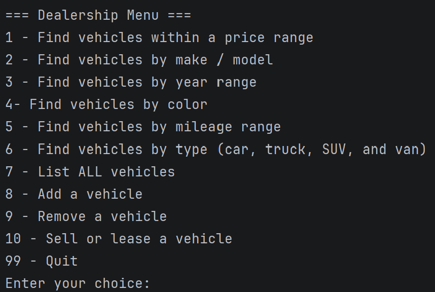
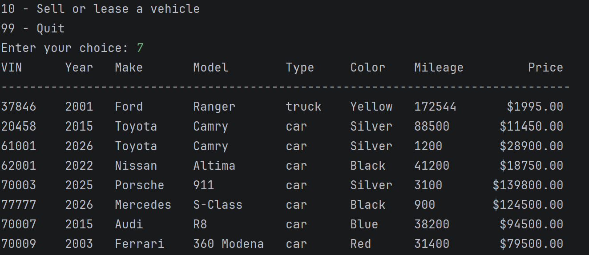

# Dealership Manager
An app for a car dealership's sales manager to search and manage the vehicles on the lot. Vehicles are saved in a file, so they are still there next time you run the app.

## Features
- View all vehicles in the inventory, shown in a table with a header row.
- Search by price range, make and model, year range, color, mileage range, or vehicle type (car, truck, SUV, and van).
- Text searches ignore capital letters, so ford finds Ford.
- Add a vehicle or remove one by its VIN. The file is saved right after every add or remove.
- Messages for a wrong menu choice, a bad number, or a search with no matches.
- Save and load vehicles using a CSV file.
- Sell or lease a vehicle by entering the VIN, the customer's name and email, and choose a sale or a lease. The app shows the total price and the monthly payment.

## How to run it
1. Clone the repository and open it in IntelliJ
2. Run 'Main.java'
3. Type a number from the menu, like 7 to list all vehicles, and press Enter

## Interesting code
A sale and a lease are written to the file with different fields on the end of the line. Instead of one big method for both, ContractDataManager uses instanceof to find out which kind of contract it was given and adds the fields that belong to it.

```java
if (contract instanceof  SalesContract) {
            SalesContract sale = (SalesContract) contract;
            type = "SALE";
            contractFields = money(sale.getSalesTaxAmount()) + "|" + money(sale.getRecordingFee()) + "|" + money(sale.getProcessingFee()) + "|" + money(sale.getTotalPrice()) + "|" + (sale.isFinanced() ? "YES" : "NO") + "|" + money(sale.getMonthlyPayment());
        } else if (contract instanceof  LeaseContract) {
            LeaseContract lease = (LeaseContract) contract;
            type = "LEASE";
            contractFields = money(lease.getExpectedEndingValue()) + "|" + money(lease.getLeaseFee()) + "|" + money(lease.getTotalPrice()) + "|" + money(lease.getMonthlyPayment());
        } else {
            System.out.println("Unknown contract type, nothing was saved.");
            return;
        }
```

## Screenshots


